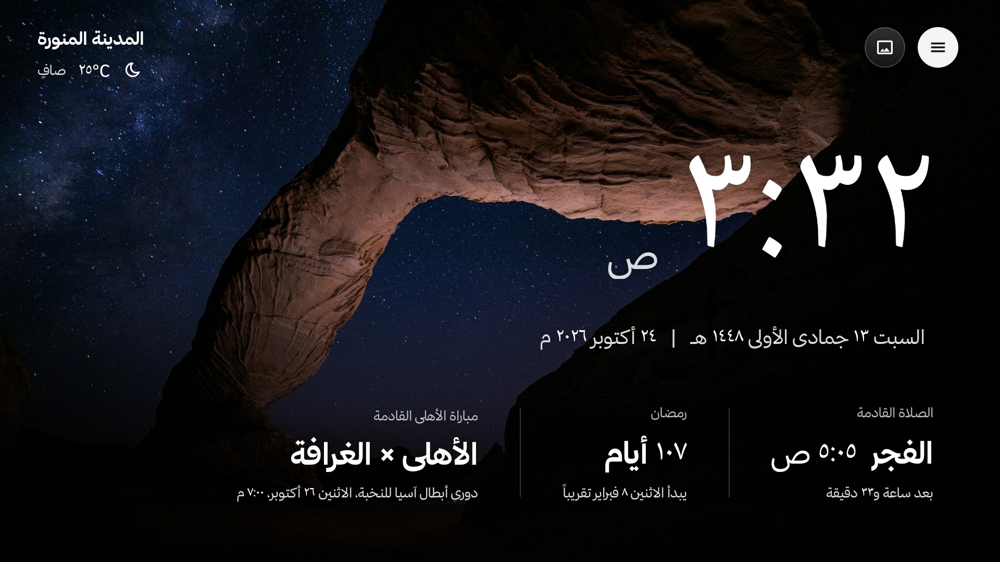
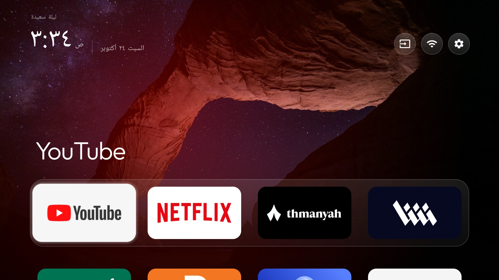
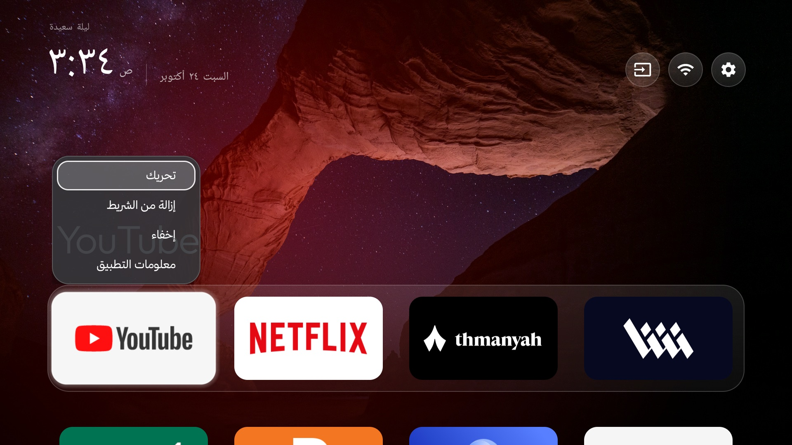
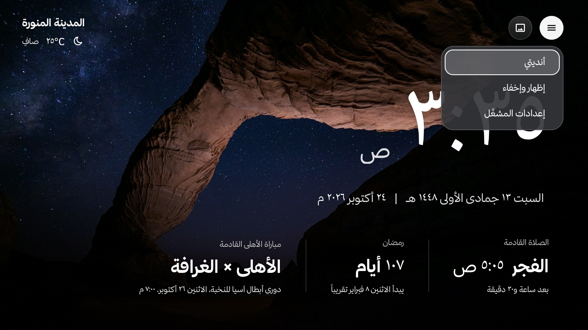
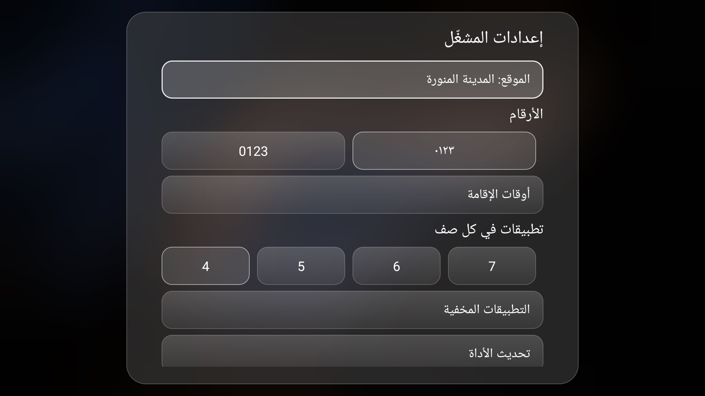
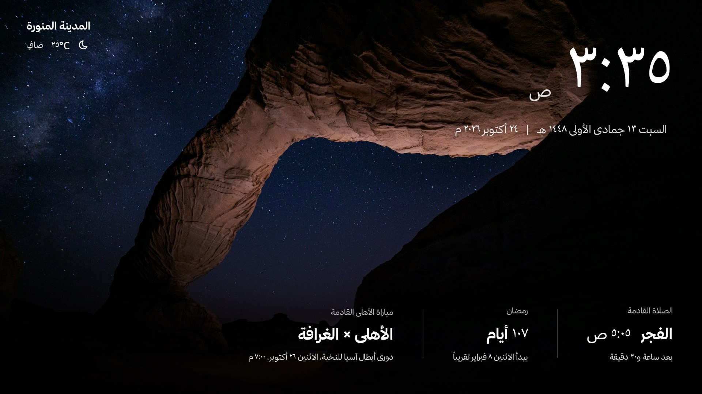

<div dir="rtl">

# شاشة رئيسية عربية نظيفة لتلفزيون Android وGoogle TV

واجهة رئيسية هادئة بدل واجهة التلفزيون المليئة بالإعلانات: المدينة والطقس، ساعة كبيرة بالتاريخين الهجري والميلادي،
الصلاة القادمة ووقت الإقامة، العدّ التنازلي لرمضان أو تهنئة العيد، ومباراة فريقك القادمة، فوق صور خلفية تتبدّل.
لا يُحذف أي تطبيق من التلفزيون، وكل شيء قابل للتراجع.

> **مبني على [Gathin23/cleanyourtv](https://github.com/Gathin23/cleanyourtv)** من Gathin (رخصة MIT).
> المشغّل، وأدوات الاتصال بالتلفزيون، وقوائم التنظيف لكل طراز، ودليل `PROMPT.md` كلها من ذلك المشروع، وهذا المستودع
> يضيف إليها الواجهة العربية. دليل المشروع الأصلي بالإنجليزية في [`README.en.md`](README.en.md).

## المزايا

- **الساعة والتاريخ:** ساعة كبيرة مع التاريخ الهجري (أم القرى) والميلادي، بأرقام لاتينية أو عربية.
- **الصلاة:** الصلاة القادمة ووقتها، تُحسب على التلفزيون نفسه بطريقة أم القرى، بلا إنترنت. بعد الأذان يظهر
  «إقامة صلاة» مع العدّ التنازلي للإقامة، والدقائق قابلة للتعديل لكل صلاة.
- **رمضان والعيد:** كم بقي على رمضان، «اليوم X من رمضان»، و«عيد مبارك» في العيدين.
- **المباريات:** المباراة القادمة للأندية التي تختارها، تتبدّل واحدة بعد الأخرى (TheSportsDB، وESPN احتياطاً).
- **الطقس:** درجة الحرارة والحالة للمدينة المختارة (Open-Meteo).
- **صور الخلفية:** صور مرفقة، ومعرض على الإنترنت يتحدّث تلقائياً، ومجلد على فلاشة USB، وGoogle Drive اختيارياً.
- **شاشة توقف** بنفس التصميم، تتحرك قليلاً كل بضع دقائق لحماية الشاشة.
- **التطبيقات:** اضغط للأسفل لتظهر التطبيقات. اضغط مطولاً على أي تطبيق لتحريكه أو إضافته للشريط أو إخفائه.
- **الإعدادات من الريموت:** زر القائمة أعلى اليمين: «أنديتي»، «إظهار وإخفاء»، «إعدادات المشغّل» (المدينة، الأرقام،
  أوقات الإقامة، عدد التطبيقات في كل صف، التطبيقات المخفية).
- **لا مفاتيح ولا اشتراكات:** كل مصادر البيانات مجانية ولا تحتاج حساباً.

**الإعدادات الافتراضية:** المدينة «المدينة المنورة»، والفريق برشلونة، والخط IBM Plex Sans Arabic. كلها تتغيّر من
الريموت أو من ملف الثيم.

## لقطات من الشاشة

لقطات من تلفزيون TCL حقيقي، بصورة خلفية من الصور المرفقة. **الخط الظاهر فيها هو خط ثمانية**، ويُثبَّت منفصلاً
(انظر «الخط: خط ثمانية» أدناه)؛ بدونه تظهر الواجهة بالخط الافتراضي IBM Plex Sans Arabic.

| | |
|---|---|
|  |  |
| **الشاشة الرئيسية:** المدينة والطقس، الساعة والتاريخان، الصلاة القادمة، رمضان، ومباراة النادي القادمة. | **التطبيقات:** اضغط للأسفل من الشاشة الرئيسية. |
|  |  |
| **الضغط المطوّل على تطبيق:** تحريك، إزالة من الشريط، إخفاء، معلومات التطبيق. | **زر القائمة ☰:** أنديتي، إظهار وإخفاء، إعدادات المشغّل. |
|  |  |
| **إعدادات المشغّل:** المدينة، الأرقام، أوقات الإقامة، عدد التطبيقات في كل صف، التطبيقات المخفية، وتحديث الأداة. | **شاشة التوقف:** نفس المعلومات بحجم أصغر، تتحرك قليلاً كل بضع دقائق. |

## المتطلبات

- **تلفزيون Android TV أو Google TV، إصدار 8 أو أحدث.** لا يعمل على Samsung (Tizen) ولا LG (webOS).
- **جهاز Mac أو Windows أو Linux** على نفس شبكة Wi-Fi التي يتصل بها التلفزيون.
- **Python 3**.
- **وكيل برمجة** يعمل في الطرفية وينفّذ الخطوات عنك (يُنصح به):
  - **[Claude Code](https://claude.com/claude-code)**: مُجرَّب على تلفزيونين.
  - **[OpenAI Codex CLI](https://github.com/openai/codex)** أو **[Gemini CLI](https://github.com/google-gemini/gemini-cli)**:
    يُفترض أن يعملا، فقواعد المشروع نفسها في `AGENTS.md` (يقرؤه Codex) و`GEMINI.md`، لكنهما **لم يُجرَّبا بعد**.
- لبناء المشغّل: **JDK 17** و**Android SDK** (يستطيع الوكيل تثبيتهما لك).

## التثبيت مع وكيل برمجة (الطريقة الأسهل)

1. **فعّل خيارات المطوّر على التلفزيون:**
   الإعدادات ← النظام ← حول ← اضغط «الإصدار» (Build) سبع مرات. ثم من «خيارات المطوّر» فعّل
   «تصحيح USB» و«تصحيح الشبكة». واكتب عنوان IP للتلفزيون من الإعدادات ← الشبكة.
   > بعض التلفزيونات تقطع الطاقة عن منافذ USB أثناء التصحيح.
2. **حمّل المشروع:**
   ```sh
   git clone https://github.com/F7FAISAL/tv-home-arabic.git
   cd tv-home-arabic
   ```
3. **افتح الوكيل في المجلد واكتب له رسالة البداية** (ضع عنوان تلفزيونك مكان 192.168.1.50):

   **Claude Code** (مُجرَّب): شغّل `claude` ثم اكتب:
   ```text
   اقرأ CLAUDE.md وREADME.md، ثم ثبّت هذه الشاشة على تلفزيوني. عنوانه 192.168.1.50.
   خذ نسخة احتياطية واكتب سكربت الاسترجاع قبل أي تغيير، وامشِ معي خطوة خطوة.
   ```

   **OpenAI Codex CLI** (لم يُجرَّب بعد): شغّل `codex` ثم اكتب:
   ```text
   اقرأ AGENTS.md وREADME.md، ثم ثبّت هذه الشاشة على تلفزيوني. عنوانه 192.168.1.50.
   خذ نسخة احتياطية واكتب سكربت الاسترجاع قبل أي تغيير، وامشِ معي خطوة خطوة.
   ```
   يمنع Codex الاتصال بالشبكة افتراضياً، والوكيل يحتاجه ليصل إلى التلفزيون: وافق عندما يطلب الإذن.

   **Gemini CLI** (لم يُجرَّب بعد): شغّل `gemini` ثم اكتب:
   ```text
   اقرأ GEMINI.md وAGENTS.md وREADME.md، ثم ثبّت هذه الشاشة على تلفزيوني. عنوانه 192.168.1.50.
   خذ نسخة احتياطية واكتب سكربت الاسترجاع قبل أي تغيير، وامشِ معي خطوة خطوة.
   ```

   عندما تظهر على التلفزيون رسالة «السماح بتصحيح USB؟» اضغط «السماح».
   سيأخذ الوكيل نسخة احتياطية، ويبني المشغّل ويثبّته، ويرسل الثيم، ويريك صورة من الشاشة بعد كل خطوة.

## التثبيت يدوياً

<div dir="ltr">

```sh
# 1. أداة الاتصال
python3 -m venv tools/venv && tools/venv/bin/pip install --only-binary=cryptography -r tools/requirements.txt
TV_HOST=192.168.1.50 tools/venv/bin/python tools/tv.py --probe

# 2. النسخة الاحتياطية وسكربت الاسترجاع: كما في PROMPT.md (قبل أي تغيير)

# 3. المشغّل مع خدمات أزرار الريموت
cd launcher && TV_HOST=192.168.1.50 INPUT_KEY_SERVICE=1 HOME_KEY_SERVICE=1 ./build-and-install.sh && cd ..

# 4. الثيم (المدينة، الأندية، الصور المرفقة، المعرض)
TV_HOST=192.168.1.50 tools/theme.sh themes/madinah

# 5. شاشة التوقف (اختياري)
TV_HOST=192.168.1.50 tools/venv/bin/python tools/tv.py 'settings put secure screensaver_components com.gathin.tvhome/.ClockDream'
```

</div>

على Google TV يجب تعطيل معالج الإعداد (setupwraith) قبل أن تصبح الشاشة الجديدة هي الرئيسية. اقرأ ملف طرازك في
`examples/` و`docs/devices/` قبل ذلك. لتغيير المدينة أو الأندية في الثيم: انسخ `themes/madinah` إلى مجلد جديد
وعدّل `config.json`، أو غيّرها من الريموت مباشرة.

## تحديث الأداة من التلفزيون

في «إعدادات المشغّل» صفّ **«تحديث الأداة»**: اضغط OK ليبحث في صفحة الإصدارات (Releases) لهذا المستودع على GitHub،
فيعرض الإصدار الحالي وأحدث إصدار. إن وُجد أحدث، اضغط OK مرة أخرى فينزّل ملف الأداة، ويتحقق من رمز SHA-256
المنشور معه، ويتأكد أنه موقّع بالمفتاح نفسه الموقّع به المشغّل المثبّت، ثم يفتح نافذة التثبيت في Android؛ اضغط
«تثبيت» بالريموت. إعداداتك على التلفزيون (الأندية، المدينة، الأرقام، التطبيقات المخفية، الثيم، الخط) تبقى كما هي.

- **يعمل فقط والمستودع عام (Public).** إن كان خاصاً يردّ GitHub بأنه لا يوجد إصدار، ولا يُحمَّل معرض الصور على
  الإنترنت أيضاً.
- يُقبل التحديث فقط إن كان موقّعاً بمفتاح المشغّل المثبّت. من بنى المشغّل على جهازه بمفتاح آخر يحدّثه من الشيفرة
  كما في «التثبيت يدوياً»، أو يجعل `update_releases_url` في `config.xml` يشير إلى إصداراته هو.
- رمز SHA-256 يكشف الملف التالف أو الناقص؛ الحماية الحقيقية هي قاعدة Android نفسها: لا يحلّ محلّ التطبيق إلا
  ملف موقّع بالمفتاح نفسه.
- ينشر صاحب المستودع الإصدارات بـ `tools/release.sh` (التفاصيل في `AGENTS.md`).

## الخط: خط ثمانية (اختياري)

الخط الافتراضي **IBM Plex Sans Arabic** (رخصة OFL المفتوحة)، وهو مرفق مع المشروع.
**خط ثمانية لا يأتي مع المشروع،** لأن رخصته تمنع إعادة نشره أو تعديله أو إعادة تسميته. لاستخدامه:

1. حمّله بنفسك من صفحة الخط الرسمية لثمانية: اضغط «تحميل الخط» واكتب بريدك، فيصلك ملف ‎.zip‎ بالبريد
   (من font@thmanyah.com). المساعدة: [مركز مساعدة ثمانية](https://ask.thmanyah.com/hc/en-001/articles/45993930027281-Thmanyah-Font-for-Everyone).
2. قل لوكيل البرمجة:
   ```text
   حمّلت خط ثمانية في ~/Downloads/Thmanyah-Font-Family.zip، ثبّته في الشاشة.
   ```
   فيشغّل:
   <div dir="ltr">

   ```sh
   python3 tools/install-thmanyah.py ~/Downloads/Thmanyah-Font-Family.zip themes/madinah
   ```

   </div>
   ينسخ السكربت ملفَّي `thmanyahsans-Regular.otf` و`thmanyahsans-Bold.otf` كما هما إلى
   `launcher/fonts-local/thmanyah/`، ويضبط `"font": "thmanyah"` في `config.local.json` الخاص بالثيم.
   ثم يرسل الثيمَ إلى كل تلفزيون، فيُرسَل الملفان معه إلى ذاكرة التلفزيون نفسه، ويقرؤهما المشغّل من هناك.
3. الخط **لا يدخل أبداً في ملف APK** (الإصدارات على GitHub عامة)، والملفان لا يُرفعان إلى git (المجلد في
   `.gitignore`)، ولا ترسلهما لأحد. يبقى الخط على التلفزيون بعد كل تحديث للأداة، وإن غاب يعود المشغّل إلى
   IBM Plex Sans Arabic.

## صور الخلفية

كل المصادر تدور معاً في عرض واحد، كل ساعة افتراضياً (`wallpaper_rotation_minutes`). كل صورة تُحفظ على التلفزيون
بمقاس 1920×1080 وحجم أقل من 500 كيلوبايت.

### 1. الصور المرفقة

صور مجلد [`wallpapers/`](wallpapers)، تُرسل إلى التلفزيون مع الثيم (`"bundle_gallery": true`)، فتعمل حتى
بلا إنترنت.

### 2. المعرض على الإنترنت (يتحدّث تلقائياً)

يقرأ التلفزيون الملف `wallpapers.json` من هذا المستودع عبر `raw.githubusercontent.com` عند التشغيل وكل 6 ساعات،
فيحمّل الصور الجديدة ويحذف ما أُزيل. لا يحتاج مفتاحاً ولا حساباً.

**إضافة صور من موقع GitHub، بلا جهاز كمبيوتر:**

1. **أزل موقع التصوير من الصورة أولاً.** الصورة الأصلية كما ترفعها تبقى في سجل المستودع العام حتى بعد تحويلها،
   ومعها أي بيانات فيها. في iPhone: افتح الصورة في «الصور» ← زر ⓘ ← «تعديل» بجانب الموقع ← «بلا موقع».
2. افتح المستودع على github.com وادخل مجلد **`wallpapers`**. من الجوال استخدم المتصفح (Safari أو Chrome)؛
   إن لم يظهر زر الرفع فاختر «عرض موقع سطح المكتب» من قائمة المتصفح. تطبيق GitHub للجوال لا يرفع الصور.
3. اضغط **Add file ← Upload files** واختر صورة أو أكثر: JPEG أو PNG أو WebP أو HEIC (صور iPhone)، بأي اسم وأي
   مقاس.
4. اترك **Commit directly to the `main` branch** مختاراً، واضغط **Commit changes**.
5. خلال دقيقة أو دقيقتين يتولّى إجراء **Wallpapers** (في تبويب Actions) الباقي: يقصّ كل صورة إلى 1920×1080،
   ويحفظها بأقل من 500 كيلوبايت، ويحذف بياناتها الوصفية، ويعطيها رقماً (`13.jpg`، `14.jpg`…)، ويحدّث
   `wallpapers.json`، ثم يحفظ ذلك في commit باسم `github-actions[bot]`. الصور الموجودة قبلها لا تتغيّر.
6. تظهر الصور على كل التلفزيونات خلال 6 ساعات، أو بعد إعادة تشغيل التلفزيون.

**لحذف صورة:** افتحها في مجلد `wallpapers` ← زر النقاط الثلاث ← **Delete file** ← Commit changes؛ يحدّث الإجراء
القائمة، ويحذفها كل تلفزيون في تحديثه القادم. إن ظهرت علامة ✗ حمراء في تبويب Actions فالسبب في الغالب ملف ليس
صورة، واسمه مكتوب في سجل الخطأ: احذفه بالطريقة نفسها.

لا ترفع إلا صوراً يحقّ لك نشرها؛ المستودع عام.

**أو من جهازك**، بالأداة نفسها التي يشغّلها الإجراء:

<div dir="ltr">

```sh
tools/venv/bin/pip install Pillow
tools/venv/bin/python tools/gallery.py add ~/Pictures/photo1.jpg ~/Pictures/photo2.jpg
git add wallpapers wallpapers.json && git commit -m "صور جديدة" && git push
```

</div>

يقصّ السكربت كل صورة إلى 1920×1080، ويحفظها بأقل من 500 كيلوبايت، ويحذف بياناتها الوصفية (الكاميرا، الموقع)،
ويحدّث `wallpapers.json`. لا ترفع إلا صوراً يحقّ لك نشرها. الرابط في `themes/madinah/config.json`
(`wallpaper_gallery_url`)؛ إن نسخت المستودع لنفسك فغيّره ليشير إلى نسختك.

### 3. فلاشة USB (اختياري)

أنشئ مجلداً اسمه **`TVWallpapers`** في أعلى أي فلاشة، وضع فيه الصور (JPEG أو PNG أو WebP، حتى 60 صورة)،
ثم أدخلها في التلفزيون. تُنسخ الصور خلال دقيقة وتبقى بعد إخراج الفلاشة. فلاشة فيها مجلد `TVWallpapers` فارغ
تمسح الصور المنسوخة. يحتاج هذا إذن قراءة التخزين، ويمنحه `build-and-install.sh` تلقائياً. لإيقافه:
`"usb_wallpapers": false` في الثيم.

### 4. مجلدك في Google Drive (اختياري)

1. أنشئ مجلداً في Google Drive وضع فيه الصور.
2. افتح [script.google.com](https://script.google.com) ← مشروع جديد، والصق محتوى
   `tools/drive-wallpapers/Code.gs`.
3. ضع معرّف مجلدك مكان `PASTE_YOUR_FOLDER_ID_HERE`: هو الجزء بعد `/folders/` في رابط المجلد.
4. من «إعدادات المشروع» فعّل «Show appsscript.json manifest file in editor»، والصق محتوى
   `tools/drive-wallpapers/appsscript.json` (صلاحية قراءة فقط).
5. Deploy ← New deployment ← Web app: Execute as **Me**، وWho has access **Anyone** ← Deploy ← Allow.
   إذا ظهرت «Google hasn't verified this app»: Advanced ← Go to the project (السكربت سكربتك أنت).
6. افتح الرابط الذي ينتهي بـ `/exec` في المتصفح؛ يجب أن ترى `{"files":[...]}` بأسماء صورك.
7. ضع الرابط في ملف `themes/madinah/config.local.json` (لا يُرفع إلى git):
   <div dir="ltr">

   ```json
   { "wallpaper_list_url": "https://script.google.com/macros/s/.../exec" }
   ```

   </div>
8. أرسل الثيم: `TV_HOST=<عنوان التلفزيون> tools/theme.sh themes/madinah`.

**لا تشارك رابطك مع أحد:** من يملكه يرى أسماء الصور في مجلدك. التفاصيل في `tools/drive-wallpapers/README.md`.

## مصادر البيانات

| البيانات | المصدر | مفتاح؟ |
|---|---|---|
| أوقات الصلاة والتاريخ الهجري | تُحسب على التلفزيون (أم القرى) | لا، وبلا إنترنت |
| المباريات | TheSportsDB (المفتاح التجريبي المجاني)، وESPN احتياطاً | لا |
| الطقس | [Open-Meteo](https://open-meteo.com) (CC BY 4.0، مذكور في إعدادات المشغّل) | لا |
| الصور | هذا المستودع، فلاشتك، مجلدك في Drive | لا |

## الإرجاع إلى الواجهة الأصلية

- شغّل سكربت الاسترجاع الذي كُتب في `backup/` قبل التغيير، أو اطلب من وكيل البرمجة: «أرجع التلفزيون كما كان».
  يعيد تفعيل كل ما عُطّل ويجعل واجهة التلفزيون الأصلية هي الرئيسية.
- أو استخدم أداة المشروع: `TV_HOST=<عنوان التلفزيون> tools/restore.sh examples/<طرازك>/debloat.txt`
- لإزالة المشغّل نهائياً بعد ذلك: `tools/venv/bin/python tools/tv.py 'pm uninstall com.gathin.tvhome'`
- **في النهاية:** أوقف «تصحيح USB» و«تصحيح الشبكة»، وألغِ تفويضات التصحيح، وأعد تشغيل التلفزيون.

## الرخصة والشكر

- الشيفرة تحت **رخصة MIT** ([`LICENSE`](LICENSE))، وحقوق المشروع الأصلي © Gathin،
  [Gathin23/cleanyourtv](https://github.com/Gathin23/cleanyourtv). شكراً له ولكل من ساهم في قوائم التلفزيونات.
- خط IBM Plex Sans Arabic تحت رخصة SIL OFL 1.1 ([`launcher/FONT-LICENSE-IBM-PLEX-SANS-ARABIC-OFL.txt`](launcher/FONT-LICENSE-IBM-PLEX-SANS-ARABIC-OFL.txt)).
- خط ثمانية ليس جزءاً من المشروع، ويخضع لرخصة ثمانية.

</div>
